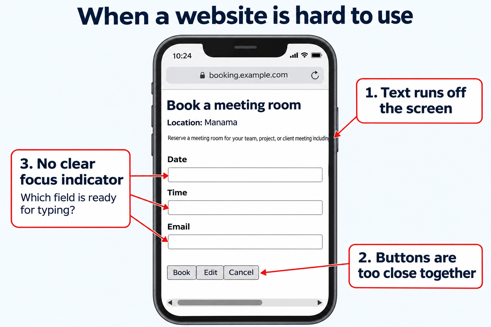

<h1>
  CSS, Accessiblity, and Responsive Design
  Concepts
</h1>

**Learning objective:** By the end of this lesson, students will be able to connect common website problems to layout and accessibility techniques.

Imagine opening a booking website on a phone. The text runs off the screen, the buttons are crowded, and you cannot tell which field is selected. The page may contain the right information, but it is difficult to use.

We can solve these problems with a few reusable techniques:

| Need | Technique we will practice |
| --- | --- |
| Keep content a comfortable width | Flexible widths, padding, and `max-width` |
| Arrange related elements | **Flexbox**, which controls the layout of direct children |
| Adjust to available space | **Responsive design**, including wrapping and media queries |
| Support different ways of using a page | **Accessibility**, including readable text and keyboard controls |

A **viewport** is the area of the browser where the webpage is displayed. Its width can change when someone resizes a window or turns a phone.

Our game page gives us a small place to practice. The same decisions apply to navigation bars, form buttons, product cards, and dashboards. Later, we will also use CSS animation to bring a decorative sprite to life.
