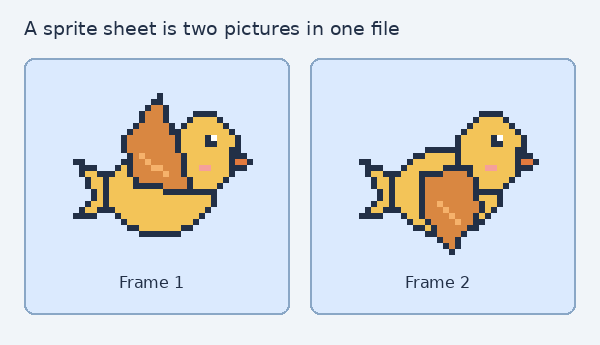

<h1>
  <span class="headline">Website Layout and Animation</span>
  <span class="subhead">Animate a Simple Sprite</span>
</h1>

**Learning objective:** By the end of this lesson, students will be able to show two image frames in turn with CSS `@keyframes`.

## Create movement from still pictures

CSS animation changes a style over time. Websites can use it for things such as a loading indicator or feedback after an action. Our example will animate a small bird.

A **sprite** is a picture used as one element of a scene. We have drawn our bird in two positions, called **frames**. Showing them in turn will make its wing appear to move. A **sprite sheet** stores those frames together in one image.



Each frame is **64px by 64px**, so our two-frame [sprite sheet](./assets/bird-sprite-sheet.png) is **128px wide** and **64px tall**. You can inspect [frame 1](./assets/bird-frame-1.png) and [frame 2](./assets/bird-frame-2.png) separately.

## Give the picture a place on the page

The image needs a home in our project. From your `game-page-layout` directory, create an `assets` folder beside `index.html`:

```bash
mkdir assets
```

Download the [bird sprite sheet](./assets/bird-sprite-sheet.png) and save it in your project's `assets` folder as `bird-sprite-sheet.png`.

We also need an element to display the bird. In `index.html`, add this **before** `</main>`:

```html
<h2>Bird animation</h2>
<div class="bird-sprite"></div>
```

An empty `<div>` has no content to give it height. Start by giving our display area the size of **one frame**. Add this rule below the existing CSS:

```css
.bird-sprite {
  width: 64px;
  height: 64px;
}
```

The space is still empty. To put the image behind it, add this inside `.bird-sprite`:

```css
background-image: url("../assets/bird-sprite-sheet.png");
```

The path starts from `css/style.css`: `..` moves up one folder, then `assets` leads to the picture. We want one copy of the strip, so also add:

```css
background-repeat: no-repeat;
```

Refresh. The 64px-wide element shows only the first part of the 128px-wide image. It acts like a small window onto the strip. This bird is decorative; any information a sprite communicates should also be available in text.

## Bring the second frame into view

The second picture sits to the right of the visible area. We can show it by moving the background one frame to the left. Inside `.bird-sprite`, add:

```css
background-position: -64px 0;
```

The first value is the horizontal position; the second is vertical. The negative horizontal value moves the image left, so the second bird now appears in the same window. The element itself has not moved.

Change that declaration back to `background-position: 0 0;` before continuing. We now know the two positions that show our two frames.

## Describe the change over time

To switch frames automatically, we need to describe how the background position changes. Add this separate rule below `.bird-sprite`:

```css
@keyframes flap {
  from {
    background-position: 0 0;
  }

  to {
    background-position: -128px 0;
  }
}
```

`flap` is a name we chose. `from` describes the start; `to` describes the end. The distance is the full strip width: **2 frames × 64px = 128px**. We will divide that distance into two steps.

This rule describes an animation, but nothing uses it yet. Inside `.bird-sprite`, connect the name and give one cycle a duration:

```css
animation-name: flap;
animation-duration: 0.6s;
```

Refresh and watch. The image slides across the window once. We want to switch between complete pictures, so a smooth slide is not the effect we need here.

## Replace sliding with frame changes

Inside `.bird-sprite`, add:

```css
animation-timing-function: steps(2);
```

`steps(2)` divides the cycle into two equal intervals. During the first interval, the background stays at `0`; during the second, it stays at `-64px`. Refresh to see the two poses without the sliding movement.

The animation still runs once and stops. To keep the wing moving, add:

```css
animation-iteration-count: infinite;
```

Now the cycle repeats. `-128px` is the boundary at the end of the cycle; the next cycle immediately returns to the first frame. We do not pause on an empty third frame.

> 🧠 These numbers depend on the image. Our sheet has two equal frames and no gap. A different sheet may require a different element size, step count, and animation distance.

## Let people choose less motion

Some people find movement uncomfortable or distracting and choose less motion in their device settings. A media query can respond to that preference. Add this after the animation rules:

```css
@media (prefers-reduced-motion: reduce) {
  .bird-sprite {
    animation-name: none;
  }
}
```

For that preference, `animation-name: none` disconnects the animation. Our starting `background-position: 0 0` leaves the first frame visible. Respecting motion preferences is useful on any website that uses animation.

> 💡 If you do not see the animation on your own computer, check whether reduced motion is enabled in your device settings.

## 🎓 You Do

Change `animation-duration` to `1.2s`. The same two frames now take twice as long to complete one cycle. Try another duration and choose a speed that makes the two poses easy to see.

**Optional: make your own artwork.** In [Piskel](https://www.piskelapp.com/), draw one **64px by 64px** frame, duplicate it, and change one detail in the second frame. Export a horizontal sprite sheet PNG with two frames and no space between them. Save it as `bird-sprite-sheet.png` in your `assets` folder. Because the frame sizes and count match, the same CSS can animate your new picture.

For more free game art, explore [Kenney's platformer sprites](https://kenney.nl/assets/new-platformer-pack). Check a sprite sheet's frame size before using it: other sheets may need different CSS numbers.
